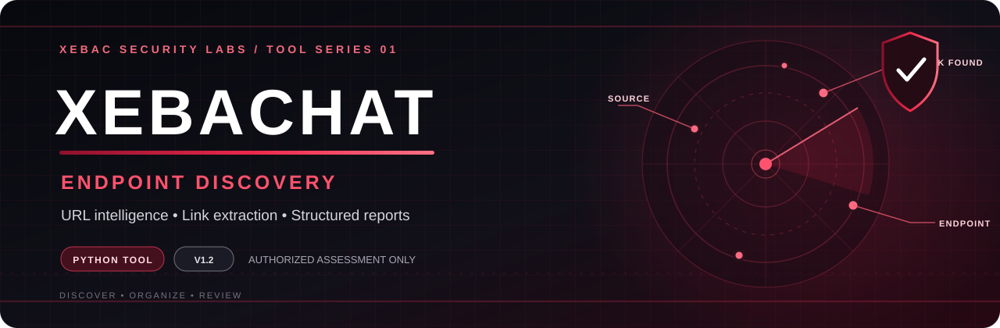

# xebachat v1.2

Endpoint and parameter discovery crawler for **authorized web assessment**.

See the project documentation, setup instructions, options, limitations, and responsible-use checklist below.



## Requirements
- Python 3.10+
- `curl_cffi` (`pip install -r requirements.txt`)

## Install
```bash
python -m venv .venv
# Windows PowerShell: .venv\Scripts\Activate.ps1
# macOS/Linux: source .venv/bin/activate
python -m pip install --upgrade pip
pip install -r requirements.txt
```

## Examples
```bash
python xebachat.py --help
python xebachat.py -u https://your-authorized-test.example -o urls.txt --jsonl crawl.jsonl --stay --respect-robots --max-depth 2 --rps 1 -t 2
python xebachat.py -r https://your-authorized-test.example/
python xebachat.py -u https://your-authorized-test.example --param --pout paths.txt --max-depth 1 --rps 1 --respect-robots
```

## Capabilities
- HTML, JavaScript, CSS, XML, JSON, PHP-like source-text and plain-text URL extraction
- Crawl and single-request modes; canonical deduplication
- Configurable threads, per-host pacing, retries, timeout, depth and URL limits
- Optional robots.txt checks, text and JSONL output, path/extension filtering
- Optional request headers, cookies, User-Agent and local Tor proxy configuration

## CLI options
| Option | Purpose |
|---|---|
| `-u`, `--url` | Crawl target |
| `-r`, `--request` | Single request; no crawl |
| `-o`, `--output` | Append unique URLs to text file |
| `--jsonl` | Structured JSON Lines output |
| `-t`, `--threads` | Worker threads (default 5) |
| `--stay` | Same approximate registrable domain only |
| `--max-depth` | Maximum crawl depth |
| `--limit` | Maximum unique output URLs |
| `--rps` | Per-host request pacing (default 5) |
| `--retries` | Transient-failure retries |
| `--timeout` | Request timeout in seconds |
| `--respect-robots` | Check robots.txt |
| `--param [VALUE]` | Path or extension-based extraction |
| `--pout FILE` | Save extracted path values |
| `--clean` | Keep final path segment |
| `-ua`, `--agent` | User-Agent |
| `--headers` | Additional request header (repeatable) |
| `--cookie` | Cookie header for authorized test accounts only |
| `--tor` | Use local Tor SOCKS proxy; not an authorization bypass |
| `-de`, `--debug` | Debug output |
| `-v`, `--version` | Version |

## Limitations
- Extraction is heuristic; dynamic routes may be missed and false positives may occur.
- JavaScript and PHP are not executed.
- `--stay` uses an approximate domain rule, not a full Public Suffix List.
- A failed robots.txt fetch is treated permissively in this version; robots.txt is not authorization.
- Redirects are followed by the HTTP client; verify target scope and redirects.
- Syntax validation alone does not prove runtime compatibility or correctness.

## Responsible use
Use only systems you own or have explicit written permission to assess. Confirm exact scope, start with low rates (`--rps 1`, `-t 1` or `-t 2`) and shallow depth, keep robots checks enabled, protect credentials and discovered sensitive data, and stop if service impact occurs or the owner requests it. Do not publish secrets, private URLs, tokens, or personal data.

## Project status
Version 1.2. The supplied Python source passed a syntax compilation check; runtime integration testing against a controlled target has not been performed during packaging.

See [SECURITY.md](SECURITY.md) and [TERMS.md](TERMS.md).